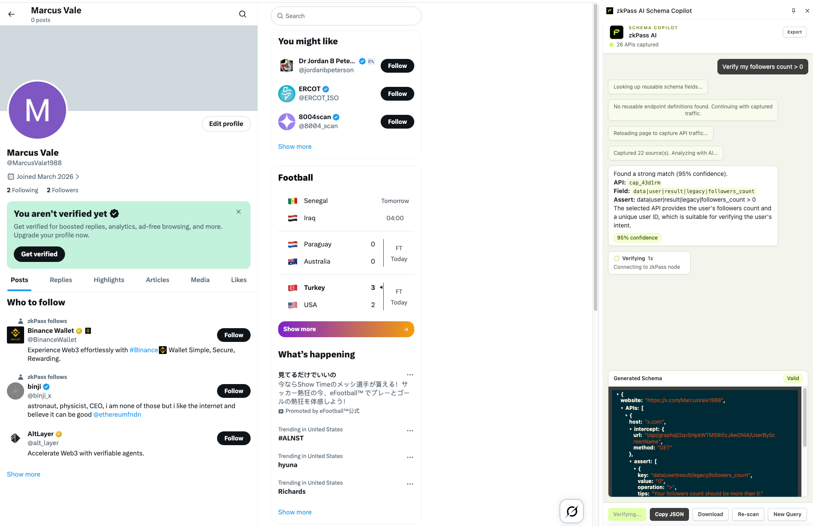

# zkPass AI Schema Copilot

zkPass AI Schema Copilot is a Chrome MV3 extension that helps users generate zkPass schemas from natural language. It opens as a side panel, observes authenticated website traffic selected by the user, asks an AI model to identify reusable API fields, and produces a zkPass schema that can be reviewed, exported, submitted, and verified.

## Screenshots



## Core Features

- Natural-language schema generation: describe what you want to prove, such as account status, KYC level, balance, membership, points, or activity.
- Authenticated API capture: records same-site API traffic, request metadata, response structures, and page HTML while the user browses the selected website.
- Lookup-first field selection: before schema generation, the extension calls the public zkPass lookup service for reusable endpoint, nullifier, matcher, and field hints. Lookup results are only used when they match APIs captured from the current page.
- Deep Agent workflow: a supervisor coordinates lookup, capture, AI analysis, schema building, confirmation gates, and verification.
- Multi-API schemas: supports using one API for the asserted data and another API for a stable identity nullifier when needed.
- Side panel chat UI: users can continue a workflow, refine intent, confirm generated schema candidates, export captured APIs, and run verification.
- Options page configuration: users can configure Claude-compatible or OpenAI-compatible model endpoints and test the connection before generating schemas.

## Tech Stack

- TypeScript (strict mode)
- React 18 for the side panel and options UI
- Vite + [`@crxjs/vite-plugin`](https://crxjs.dev/vite-plugin) for the MV3 build
- Tailwind CSS (scoped to the side panel and options UI)
- Zustand for UI state
- [`@zkpass/transgate-extension-sdk`](https://www.npmjs.com/package/@zkpass/transgate-extension-sdk) for in-extension zkTLS verification
- Chrome Manifest V3 (background service worker, side panel, options page)

## How It Works

1. Open a target data source website and log in.
2. Open zkPass AI Schema Copilot from the extension icon or the right-click `Generate Schema` menu.
3. Describe the proof you want to create in the chat box.
4. The agent calls the zkPass Lookup API for the current host.
5. The extension captures or reuses current tab API traffic and page HTML.
6. Matched lookup endpoints and fields are prioritized. Uncaptured lookup entries are used only as navigation hints.
7. The AI selects APIs, fields, conditions, and nullifiers, then builds a zkPass schema.
8. Review the generated candidate, confirm it, and optionally submit or verify it.

The detailed Deep Agent flow is maintained in [`docs/chatbox-interaction-mindmap.html`](docs/chatbox-interaction-mindmap.html). When the schema generation flow changes, update that document together with the code.

## Install from Chrome Web Store

Install the published extension from the Chrome Web Store:

[zkPass AI Schema Copilot](https://chromewebstore.google.com/detail/zkpass-ai-schema-copilot/iojilfnfdddkghnhieddjpppgnhnlfgc)

After installation, pin the extension in Chrome and open it on the website where you want to create a zkPass schema.

## Development

Requirements: Node.js >= 18 and npm.

```bash
# Install dependencies
npm install

# Start the dev server with HMR
npm run dev

# Type-check, lint, format
npm run typecheck
npm run lint
npm run format

# Production build (outputs to dist/)
npm run build
```

### Load the unpacked extension in Chrome

1. Run `npm run build` (or `npm run dev` for a development build).
2. Open `chrome://extensions`.
3. Enable `Developer mode` (top right).
4. Click `Load unpacked` and select the generated `dist/` directory.
5. Pin the extension and open the target website to start building a schema.

When using `npm run dev`, keep the dev server running; the extension reloads on change.

## Initial AI Configuration

Open the extension options page before generating schemas:

1. Go to `chrome://extensions`.
2. Find `zkPass AI Schema Copilot`.
3. Click `Details`.
4. Click `Extension options`.
5. Select an AI provider.
6. Fill in `API Endpoint`, `API Key`, and `Model`.
7. Click `Test Connection`.
8. Click `Save Settings`.

The configuration is saved in Chrome local extension storage as `ai_config`. Your API key never leaves the browser except in requests to the AI endpoint you configure.

## Endpoint and Model Configuration

The `API Endpoint` field expects the provider base URL, not the full chat completion path. The extension appends the provider-specific API path internally.

### Claude-Compatible Provider

Default endpoint:

```text
https://api.anthropic.com
```

Default model:

```text
claude-opus-4-7
```

Request path used by the extension:

```text
{endpoint}/v1/messages
```

The Claude request uses:

- `x-api-key`
- `anthropic-version: 2023-06-01`
- `anthropic-dangerous-direct-browser-access: true`
- `max_tokens`

Use a Claude-compatible base URL if you route requests through a proxy. For example:

```text
https://your-claude-proxy.example.com
```

### OpenAI-Compatible Provider

Default endpoint:

```text
https://api.openai.com
```

Default model:

```text
gpt-4o
```

Request path used by the extension:

```text
{endpoint}/v1/chat/completions
```

Connection test path:

```text
{endpoint}/v1/models
```

The OpenAI request uses:

- `Authorization: Bearer <API_KEY>`
- `temperature: 0.2`
- `max_completion_tokens`

Use an OpenAI-compatible base URL if you use a proxy or compatible gateway. For example:

```text
https://your-openai-compatible-gateway.example.com
```

## Lookup API

Before generating a schema, the extension calls:

```text
POST https://schema-builder.zkpass.org/lookup
```

Payload:

```json
{
  "host": "www.example.com"
}
```

Lookup results provide known endpoints, request matchers, nullifier fields, and assertion field purposes. The schema agent only prioritizes lookup endpoints after they match captured page traffic by host, method, path, and optional query/body/header matcher. If lookup returns no results or the service is unavailable, schema generation continues with captured traffic analysis.

## Permissions

The extension requests the following permissions. Each is required for the schema-generation workflow:

| Permission | Why it is needed |
|---|---|
| `host_permissions: <all_urls>` | The user can choose any authenticated website to build a schema from. The extension only reads traffic for the tab the user is actively working on. |
| `webRequest` | Passively observe API requests on the active page so their structure can be analyzed. (No blocking/redirecting variant is used.) |
| `scripting` | Inject code into the page to read the DOM and to replay a captured request with the user's session so a clean response body can be sampled. |
| `tabs` | Read the active tab URL/host and reload it to trigger the target request. |
| `webNavigation` | Track single-page-app navigations so the active host stays correct. |
| `storage` | Save the AI configuration and captured request data locally in the browser. |
| `sidePanel` | Provide the chat UI. |
| `activeTab` | Interact with the current tab on user action. |
| `contextMenus` | Add the right-click `Generate Schema` entry. |

## Privacy and Data Handling

This extension observes authenticated web traffic, so data handling is intentionally minimal and stays local by default.

- **Stored locally only.** The AI configuration (provider, endpoint, model, API key) is stored in `chrome.storage.local`. Captured requests and transient workflow state are stored in `chrome.storage.session` and cleared when the service worker unloads. None of this is sent to any zkPass server.
- **What is sent to the AI provider.** During analysis, the extension sends the AI endpoint you configured a compact summary of captured API candidates: URL, method, host, path, and response field names with truncated, masked sample values. Raw cookies, `Authorization` headers, and full request/response bodies are **not** sent to the AI provider.
- **What is sent to zkPass.** The lookup call sends only the current site host (e.g. `www.example.com`). On submit, the generated schema (field paths and conditions, not raw captures) is sent to the zkPass schema service. Verification runs via the TransGate zkTLS SDK.
- **No telemetry.** The extension contains no analytics or tracking.
- **Local export note.** The optional "export captured APIs" feature writes an HTML file to your machine that may contain raw request headers and bodies. It is generated locally and never uploaded; treat the file as sensitive.

## Common Workflow

1. Configure the AI provider in the options page.
2. Visit the target website and log in.
3. Browse to the page that contains the data you want to prove.
4. Open the side panel or right-click and choose `Generate Schema`.
5. Ask for a schema in plain language.
6. If the agent reports missing data, navigate to the suggested page and ask it to continue.
7. Confirm the candidate schema.
8. Export, submit, or verify the generated schema.

## Project Structure

```text
src/background/      Chrome background service worker, capture, storage, messages, verification
src/sidepanel/       Chat UI, schema preview, export and verification controls
src/options/         AI provider configuration page
src/agents/          Deep Agent supervisor and specialized subagents
src/ai/              LLM prompts, API clients, response parsing
src/lookup/          zkPass Lookup API client and captured-endpoint matcher
src/network/         webRequest interception, field indexing, value masking
src/schema/          zkPass schema builder and validator
src/reference/       zkPass schema syntax reference used in AI prompts
src/shared/          Shared constants, message types, and data types
```

## Troubleshooting

- `Test Connection` fails: check the API key, provider, base endpoint, and model name.
- OpenAI returns `Unsupported parameter: max_tokens`: use a model/API that supports Chat Completions with `max_completion_tokens`; the extension already sends `max_completion_tokens` for OpenAI-compatible calls.
- No APIs captured: keep the side panel open, reload the target page, and interact with the feature that contains the data.
- Lookup returns no endpoints: this is not a blocking error. The agent falls back to captured API analysis.
- Generated schema misses a field: browse to the exact page where the website loads that data, then ask the agent to continue.

## Contributing

Contributions are welcome. Please read [CONTRIBUTING.md](CONTRIBUTING.md) for the development workflow and code standards, and [SECURITY.md](SECURITY.md) for how to report vulnerabilities.

## License

Released under the [MIT License](LICENSE). Copyright (c) 2026 zkPass.
